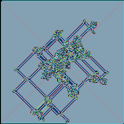
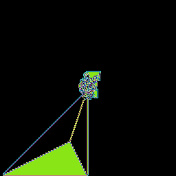
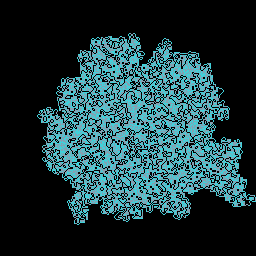
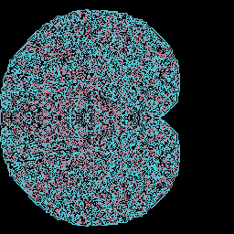

# Langton's ant pattern gallery

- [Langton's ant pattern gallery](#langtons-ant-pattern-gallery)
  - [Classic patterns](#classic-patterns)
  - [Novel patterns](#novel-patterns)

## Classic patterns

  
Classic Langton's ant pattern.  
FSM: `RL`

  
Fills space in a square around itself.  
FSM: `LRRRRRLLR`

  
Creates a convoluted highway.  
FSM: `LLRRRLRLRLLR`

  
Creates a triangle away from the center.  
FSM: `RRLLLRLLLRRR`

  
Grows chaotically.  
FSM: `RLR`

  
Grows symmetrically.  
FSM: `LLRR`

## Novel patterns

  
Creates a prism.  
Ants:

1. FSM: `RLRRLRRLRRLR`, Dir: `N`
2. FSM: `RLC`, Dir: `N`
