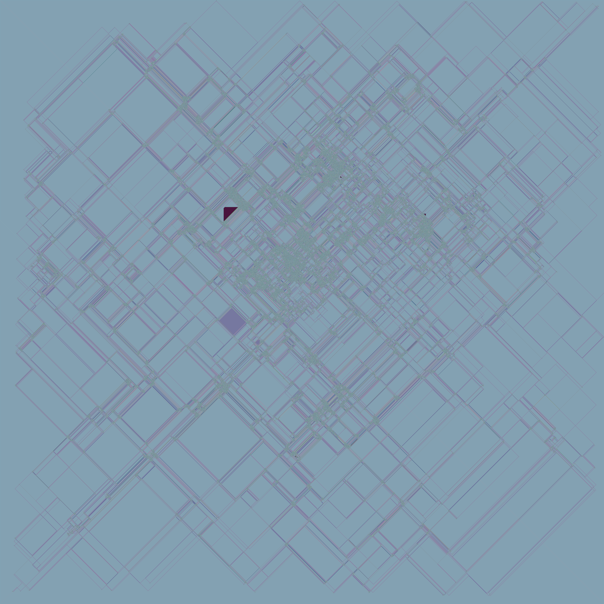

## langtons-ant

<p align="center">
  
</p>
<hr>

This repository contains a C++ and web implementation of the [Langton's ant](https://wikipedia.org/wiki/Langton's_ant) universal Turing machine.

The web version can be found [here](https://rafa-br34.github.io/LangtonsAnt)

## Table of contents

- [Implementation notes](#implementation-notes)
- [Usage](#usage)
  - [Web version](#web-version)
  - [C++ versions](#c-versions)
    - [`langtons_ant_direct.cpp` VS `langtons_ant_eval_cli.cpp`](#langtons_ant_directcpp-vs-langtons_ant_eval_clicpp)
    - [Building](#building)
    - [Eval CLI Arguments](#eval-cli-arguments)
      - [`-x` \& `-y`](#-x---y)
      - [`-m`](#-m)
      - [`-a`](#-a)
      - [`-i`](#-i)
      - [`-s`](#-s)
      - [`-o`](#-o)
      - [`-t`](#-t)

# Implementation notes

The TypeScript ([ant.ts](https://github.com/rafa-br34/LangtonsAnt/blob/master/website/src/lib/ant.ts)) version is basically a line by line rewrite of the C++ ([ant.h](https://github.com/rafa-br34/LangtonsAnt/blob/master/src/types/ant.h)) version (in the future this may change).  
There's support for 8 possible operations, which are:

- R45/L45
- R90/L90 (or R/L)
- R135/L135
- C (continue)
- U (180 degree turn)

# Usage

## Web version

The site lives in [`website/`](website) and is a **Next.js static export** built with React, TypeScript,
Tailwind CSS and [Base UI](https://base-ui.com/). It runs the simulation in JavaScript and uploads the grid
to a WebGL2 shader, so the browser only has to move one texture per frame.

```bash
cd website
npm install
npm run dev       # local dev server
npm run build     # static export in website/out
npm run typecheck
```

For a GitHub Pages project site such as `https://rafa-br34.github.io/LangtonsAnt/`, build with the
repository name as the base path:

```bash
NEXT_PUBLIC_BASE_PATH=/LangtonsAnt npm run build
```

The interface is a small lab bench:

- **Start / Pause** runs the simulation at the current *iterations per frame*.
- **Step** advances a single frame while paused, **Reset** clears the grid.
- **Drag** the canvas to pan, **scroll** to zoom, and **Reset view** to recenter.
- The ant editor exposes position, an eight-way facing pad, step size, wrap/enabled
  switches and the state machine. `R`/`L` turn 90°, `R45`/`L45` and `R135`/`L135`
  turn diagonally, `U` reverses and `C` continues straight.
- **Copy link** stores the full world in the URL so a run can be shared.
- **Save PNG** downloads a snapshot of the current frame.

Keyboard shortcuts: `Space` start/pause, `S` step, `R` reset, `C` reset the view and
`?` for the about dialog.

The page is deployed by [`.github/workflows/static.yml`](.github/workflows/static.yml), which installs the
website dependencies, builds the static export with the Pages base path, and uploads `website/out`.

## C++ versions

### `langtons_ant_direct.cpp` VS `langtons_ant_eval_cli.cpp`

The `langtons_ant_direct.cpp` file is an example implementation of how you can use this repo to implement your own Langton's ant simulation.  
The `langtons_ant_eval_cli.cpp` file on the other hand is a simple CLI that allows you to mess around without needing any C++ knowledge.

### Building

The following works for both Linux and Windows.

```bash
git clone --recursive https://github.com/rafa-br34/LangtonsAnt.git
cd LangtonsAnt
mkdir build
cd build
cmake .. -DCMAKE_BUILD_TYPE=Release
cmake --build . -j 32 --
```

### Eval CLI Arguments

#### `-x` & `-y`

Canvas width/height

#### `-m`

Defines a state machine, can later be used when defining a ant with `-a`.  Can be chained using `;`  
Example:  
`-m LRRRRRLLR;RLLLLLRRL`: Creates two state machines with index 0 and 1

#### `-a`

Defines ants using the following format `P(X,Y)D(DX,DY)M(M)S(S)F(W?)` which can be chained using `;`

- `P` Initial position
- `D` Initial direction
- `M` Defines which state machine to use, this can be a string (for example `RL`/`R90L90`) or a index when using the `-m` argument
- `S` Defines the step size
- `F` Optional section that defines flags (W: Wrap)

Example:  
`-a P(500,500)D(0,-1)M(RL)`: Creates a single ant with the state machine `RL`  
`-a P(500,500)D(0,-1)M(0)S(10)F(W);P(500,500)D(0,1)M(1)`: Creates two ants using state machine 0 and 1, ant 0 wraps and has a step size of 10  

#### `-i`

Defines how many iterations should be evaluated, by default it will run until all ants run out of bounds or (if wrap is enabled) will run indefinitely. Alternatively `t` can be added before the number to make it time based.  
Example:  
`-i i50b`: Run for 50 billion iterations  
`-i t100s`: Run a maximum of 100 seconds  

#### `-s`

Defines when a canvas snapshot should be taken. Can be chained using `;`

- `i<interval?>`: Snapshots every `interval` iterations (if not specified 1 is assumed)
- `f`: Snapshots the final state

#### `-o`

Defines how to output images.  

- `f:<format>:<name>`: Write image files. `%d` can be used for the image index and `%i` for the current iteration.
- `s:<format>:<stdout|stream>:<stream_name?>`: Write images to a pipe/stream.  
Supported formats:  
- `idx`: Outputs the raw buffer.
- `rgb24`: Outputs the raw buffer as RGB24.
- `png`: Outputs the raw buffer as PNG.

#### `-t`

Defines how many threads should be used, for now this argument only changes the amount of threads used when encoding images, *eventually* multithreading for the ants will also be added.
